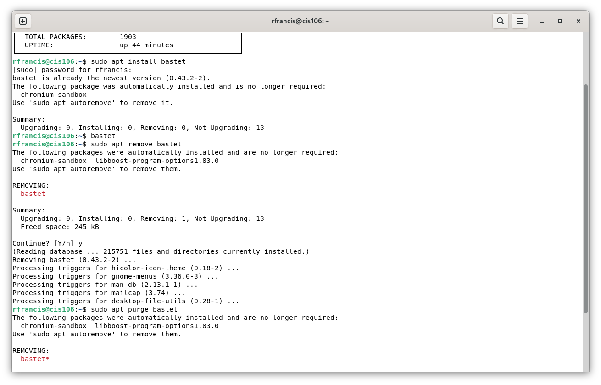
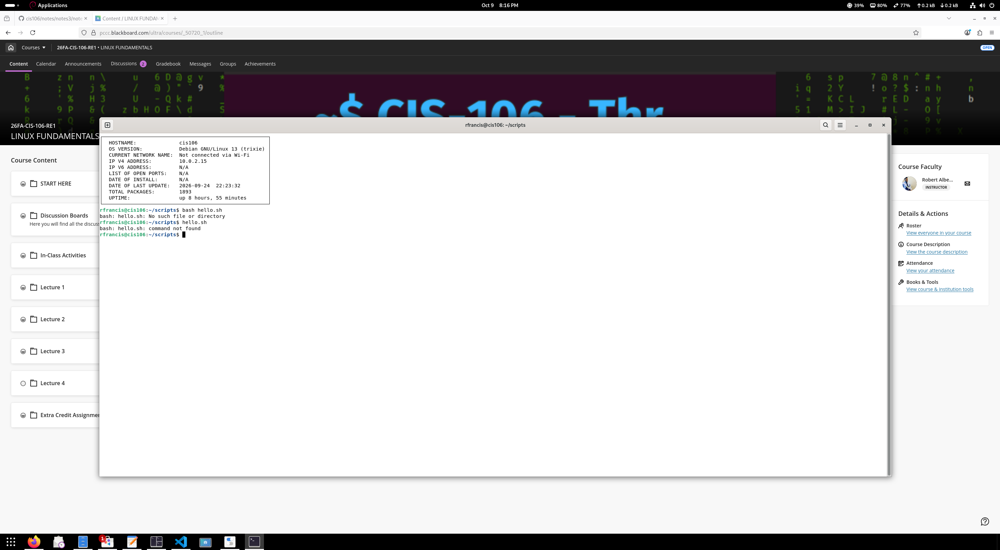

# Notes 4

## How to install and remove software using the APT command

APT is used to manage software packages in Debian Linux. The command `sudo apt update` updates package lists, `apt search "tetris"` searches for packages, and `sudo apt install bastet` installs software. The command `apt show bastet` displays package information. To remove software, use `sudo apt remove cuyo`, which retains system-wide configuration files, or `sudo apt purge cuyo`, which removes them. The commands `sudo apt clean`, `sudo apt autoclean`, and `sudo apt autoremove` help clean the package cache and remove unnecessary packages.

## How to create a shell script

### Step 1 Create the file

Open GNOME Text and save a new file as `hello.sh` in your `scripts/` directory.

### Step 2 Add shell declaration

Add `#!/bin/bash` as the first line to tell Linux to use Bash to execute the script.

### Step 3 Add your code

Add `echo "Hello World"` to display text. You can also use `date` to display the date and time, `whoami` to display the current username, `free -h` to display memory usage, and `df -h` to display disk usage.

### Step 4 Run the script

Open the terminal, navigate to the script's directory using `cd ~/scripts`, and run it with `bash hello.sh`. You can make it executable with `chmod +x hello.sh` and then run it using `./hello.sh`. Save your script before running it and check the filename and directory if you encounter errors.

## Screenshots
### Managing Software

### Shell Scripting

